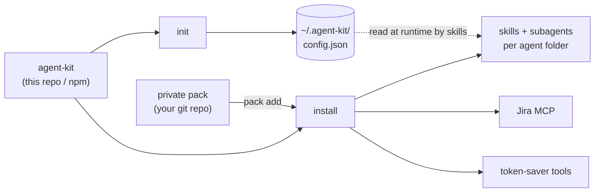

# agent-kit

One installer for AI coding agents (Claude Code, Cursor, Gemini CLI, Antigravity, Codex). It copies the same
skills and subagents into each agent's folder, wires up the Jira MCP, sets a Slack allowlist, installs optional
token-saver tools, and lets your team add private skill packs from its own git repo.

No company keys, IDs or handles are baked in. Each person enters their own in `init`. No passwords or API
tokens are asked for or stored.

## Install

```bash
# from npm
npx @ednaaaj/agent-kit init
npx @ednaaaj/agent-kit install

# or from source
git clone git@github.com:ednaaaj/movegent-kit.git agent-kit && cd agent-kit
node bin/cli.mjs init
node bin/cli.mjs install
node bin/cli.mjs doctor
```

Flags: `--agents=claude,cursor`, `--tools=rtk,headroom`, `--pack=<git-url|path>`, `--skip-mcp`, `--skip-tools`, `--dry-run`.

Claude Code plugin route: `claude plugin marketplace add ednaaaj/movegent-kit`, then
`claude plugin install agent-kit@agent-kit`. Use the plugin OR `install`, not both, or you get duplicate skills.



## What `init` asks

Nothing is required: press Enter to skip any question. Answers are saved to `~/.agent-kit/config.json`, on your machine only.

| # | Question | Example | Used for |
| --- | --- | --- | --- |
| 1 | Workspace folder | `~/work` | where skills find your repos |
| 2 | GitLab username | `jdoe` | MR author / assignee |
| 3 | Main GitLab project path | `group/sub/repo` | `glab` API calls |
| 4 | MR reviewers | `alice,bob` | reviewers on new MRs |
| 5 | Jira site host | `yourco.atlassian.net` | Jira links; the cloudId is looked up for you |
| 6 | Slack channel name | `#team-reviews` | where MR posts go (blank skips Slack) |
| 7 | Slack channel ID | `C0123ABCD` | from the channel's details; re-asks if invalid |
| 8 | People to DM / @mention | `Alice,U0123ABCD` | one per line, blank line to finish |
| 9 | Who is always @mentioned | `Alice` | blank = everyone listed |
| 10 | Let the agent send without asking? | `n` | default `n`: it only drafts |

`install` asks two things: which agents you use, and which extra tools you want. Jira login happens in your
browser the first time an agent uses Jira. Details: [docs/config.md](docs/config.md).

## What's inside

| Folder | Purpose |
| --- | --- |
| `skills/` | skills copied into each agent's skills folder |
| `agents/` | Claude-format subagents (installed for Claude Code only) |
| `manifests/` | per-agent and per-tool tables the CLI reads |
| `schemas/` | JSON schemas, including the config file |
| `bin/` | `cli.mjs`, the zero-dependency installer |
| `docs/` | detailed docs, linked below |
| `examples/` | example config and a minimal working pack |
| `scripts/` | maintenance scripts |
| `tests/` | tests for the CLI and content |
| `.claude-plugin/` | Claude Code plugin and marketplace metadata |

## Repository layout

```text
agent-kit/
  bin/cli.mjs
  skills/        jira-transition, ship, ticket-to-mr, mr-babysit, mr-review, mp-*
  agents/        mr-intake, mr-shipper, mr-reviewer, airasia-phoenix-*, mp-*-writer, ...
  manifests/     agents.json, tools.json
  schemas/       config.schema.json
  docs/          architecture, agents, tools, packs, workflow, config
  examples/      config.example.json, pack/
  scripts/
  tests/
  .claude-plugin/
```

## Docs

- [docs/architecture.md](docs/architecture.md): how the pieces fit, what `install` does
- [docs/agents.md](docs/agents.md): which agent reads what, adding an agent
- [docs/tools.md](docs/tools.md): token-saver tools, adding a tool
- [docs/packs.md](docs/packs.md): private skill packs
- [docs/workflow.md](docs/workflow.md): ticket-to-MR pipeline and guardrail skills
- [docs/config.md](docs/config.md): every config key
- [AGENTS.md](AGENTS.md), [CONTRIBUTING.md](CONTRIBUTING.md), [SECURITY.md](SECURITY.md),
  [TROUBLESHOOTING.md](TROUBLESHOOTING.md), [CHANGELOG.md](CHANGELOG.md)

## License

MIT. Third-party tools are installed from their own upstream repos under their own licences.
Layout inspired by affaan-m/ECC (MIT).
