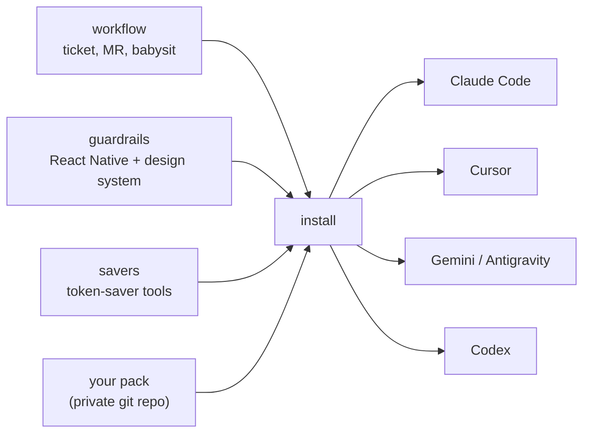

# agent-kit

**Set up your team's AI coding agents with one command.**

Everyone gets the same skills, the same Jira connection and the same habits, whether they use Claude Code,
Cursor, Gemini CLI, Antigravity or Codex. Setup takes a few minutes, and each person picks only what their work needs.

- **Ticket to merge request.** The agent reads a Jira ticket, makes a branch, writes the change, opens the merge
  request, and then keeps fixing CI and review comments until it is ready for you to merge.
- **Team rules the agent follows.** Frontend guardrails for React Native and design-system projects, plus review
  checklists.
- **Lower token use.** Optional tools that shrink what the agent reads and writes.
- **Your own skills on top.** Add your team's private skills from your own git repo.

Nothing about your company is built in. You enter your own Jira site, GitLab project and Slack channel once, and
they stay on your machine. No passwords or API tokens are asked for or stored.

## Install

```bash
# from npm
npx @ednaaaj/agent-kit init
npx @ednaaaj/agent-kit install

# or from source
git clone git@github.com:ednaaaj/movegent-kit.git agent-kit && cd agent-kit
node bin/cli.mjs init
node bin/cli.mjs install
node bin/cli.mjs doctor
```

Flags: `--agents=claude,cursor`, `--bundles=workflow,guardrails`, `--tools=rtk,headroom`,
`--pack=<git-url|path>`, `--skip-mcp`, `--skip-tools`, `--dry-run`.

Your bundle choice is saved in `~/.agent-kit/config.json`, so repeat installs without a terminal reuse it.



## What `init` asks

Nothing is required: press Enter to skip any question. Answers are saved to `~/.agent-kit/config.json`, on your machine only.

| # | Question | Example | Used for |
| --- | --- | --- | --- |
| 1 | Repo folder to work in | blank | optional. Blank means the git root of the folder your agent runs in, so repos can live anywhere |
| 2 | Design-system checkout | blank | optional, only the guardrails bundle uses it |
| 3 | GitLab username | `jdoe` | MR author / assignee |
| 4 | Main GitLab project path | `group/sub/repo` | `glab` API calls |
| 5 | MR reviewers | `alice,bob` | reviewers on new MRs |
| 6 | Jira site host | `yourco.atlassian.net` | Jira links; the cloudId is looked up for you |
| 7 | Slack channel name | `#team-reviews` | where MR posts go (blank skips Slack) |
| 8 | Slack channel ID | `C0123ABCD` | from the channel's details; re-asks if invalid |
| 9 | People to DM / @mention | `Alice,U0123ABCD` | one per line, blank line to finish |
| 10 | Who is always @mentioned | `Alice` | blank = everyone listed |
| 11 | Let the agent send without asking? | `n` | default `n`: it only drafts |

`install` asks which agents you use, which bundles you want, and which extra tools. Jira login happens in your
browser the first time an agent uses Jira. Details: [docs/config.md](docs/config.md).

## Bundles

| Bundle | Contents | Who needs it |
| --- | --- | --- |
| `workflow` | `ship`, `ticket-to-mr`, `mr-babysit`, `mr-review`, `jira-transition`, plus the `mr-intake`, `mr-shipper`, `mr-reviewer` subagents | everyone who works tickets into MRs |
| `guardrails` | 11 `mp-*` skills and 10 subagents for React Native and a design system | frontend / mobile devs; backend devs can skip it |
| `savers` | token-saver tool recipes (caveman, ponytail, rtk, headroom, context-mode, graphify) | anyone who wants smaller context use |

Your own pack counts as one more bundle and is always installed. See [docs/packs.md](docs/packs.md).

## Repository layout

```text
agent-kit/
  bin/cli.mjs            installer
  targets.json           where each agent reads skills, subagents and MCP
  bundles/
    workflow/            skills/ and agents/
    guardrails/          skills/ and agents/
    savers/tools.json    token-saver recipes
  docs/                  detailed docs
  examples/              example config and a minimal pack
  scripts/ tests/        validator and test suite
```

## Docs

- [docs/architecture.md](docs/architecture.md): how the pieces fit, what `install` does
- [docs/agents.md](docs/agents.md): which agent reads what, adding an agent
- [docs/tools.md](docs/tools.md): token-saver tools, adding a tool
- [docs/packs.md](docs/packs.md): private skill packs
- [docs/workflow.md](docs/workflow.md): ticket-to-MR pipeline and guardrail skills
- [docs/config.md](docs/config.md): every config key
- [docs/troubleshooting.md](docs/troubleshooting.md): common problems
- [AGENTS.md](AGENTS.md), [CONTRIBUTING.md](CONTRIBUTING.md), [SECURITY.md](SECURITY.md), [CHANGELOG.md](CHANGELOG.md)

## License

MIT. Third-party tools are installed from their own upstream repos under their own licences.
