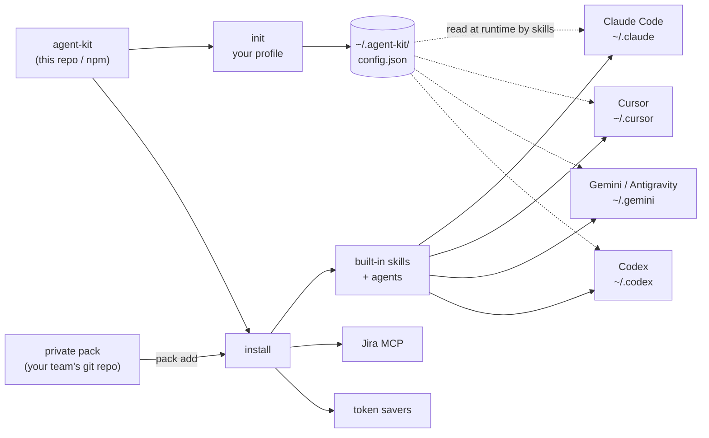
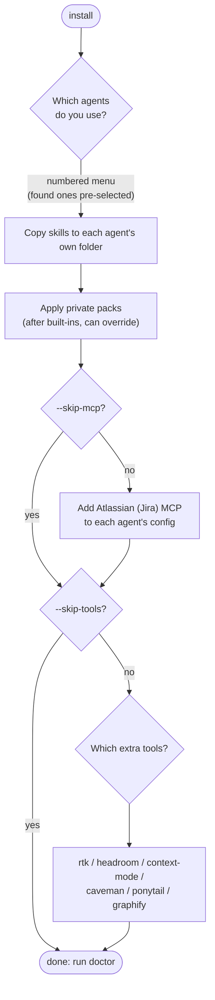
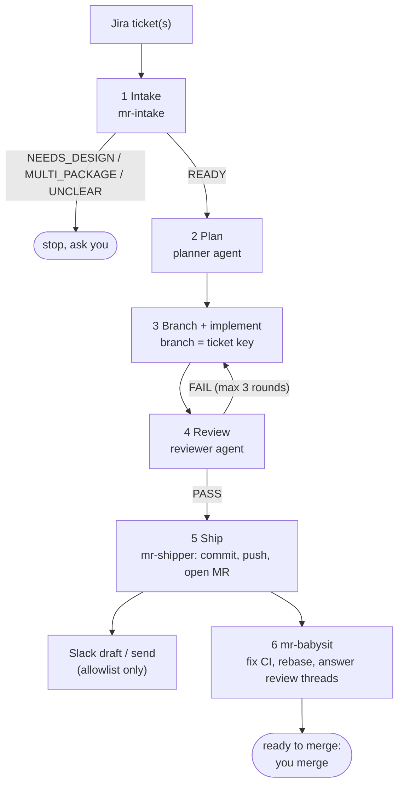
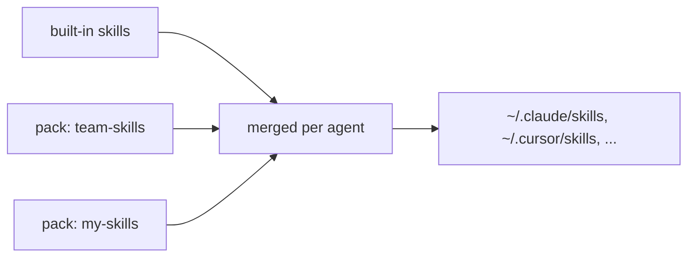

# agent-kit

One installer for AI coding agents (Claude Code, Cursor, Antigravity / Gemini CLI, Codex).

It gives every teammate the same setup in a few minutes:

- a **ticket-to-MR workflow** (Jira ticket → branch → code → review → merge request → babysit CI)
- **frontend guardrail skills** for React Native + design-system projects
- **Jira MCP** and a **Slack allowlist** (the agent drafts or sends only to people you list)
- **token savers**: caveman, ponytail, rtk, headroom, context-mode, graphify
- **private skill packs**: your team adds its own skills on top, from its own git repo

No company keys, IDs or handles are baked in. Each person enters their own in `init`.
No passwords or API tokens are ever asked for or stored.

## How it fits together



## Install

```bash
# from npm
npx @ednaaaj/agent-kit init
npx @ednaaaj/agent-kit install

# or from source
git clone git@github.com:ednaaaj/movegent-kit.git agent-kit && cd agent-kit
node bin/cli.mjs init
node bin/cli.mjs install
node bin/cli.mjs doctor
```

Flags: `--agents=claude,cursor`, `--tools=rtk,headroom`, `--pack=<git-url>`, `--skip-mcp`, `--skip-tools`, `--dry-run`.
Update: `git pull && node bin/cli.mjs install --skip-tools` (or rerun `npx @ednaaaj/agent-kit install`).

### What `install` does



## What it asks you

Nothing is required: press Enter to skip any question.

**`init`** saves your answers to `~/.agent-kit/config.json`, on your machine only:

| # | Question | Example | Used for |
| --- | --- | --- | --- |
| 1 | Workspace folder | `~/work` | where skills find your repos |
| 2 | GitLab username | `jdoe` | MR author / assignee |
| 3 | Main GitLab project path | `group/sub/repo` | `glab` API calls |
| 4 | MR reviewers | `alice,bob` | reviewers on new MRs |
| 5 | Jira site host | `yourco.atlassian.net` | Jira links; the cloudId is looked up for you |
| 6 | Slack channel name | `#team-reviews` | where MR posts go (blank skips Slack) |
| 7 | Slack channel ID | `C0123ABCD` | from the channel's details; re-asks if invalid |
| 8 | People to DM / @mention | `Alice,U0123ABCD` | one per line, blank line to finish |
| 9 | Who is always @mentioned | `Alice` | blank = everyone listed |
| 10 | Let the agent send without asking? | `n` | default `n`: it only drafts |

Finding the Slack IDs: open the channel's details for the channel ID, and a person's profile → ⋮ → *Copy member ID*.

**`install`** asks two things: which **agents** you use, and which **extra tools** you want.
Jira login happens in your browser the first time an agent uses Jira: you sign in as yourself.

## Which agent reads what

| Agent | Skills | Subagents | Jira MCP |
| --- | --- | --- | --- |
| Claude Code | `~/.claude/skills` | `~/.claude/agents` | `claude mcp add` |
| Cursor | `~/.cursor/skills` | not installed | `~/.cursor/mcp.json` |
| Gemini CLI | `~/.gemini/skills` | not installed | `~/.gemini/settings.json` |
| Antigravity | `~/.gemini/antigravity/skills` | not installed | `~/.gemini/antigravity/mcp_config.json` |
| Codex | `~/.codex/skills` | not installed | `codex mcp add` |

Gemini, Antigravity and Codex also get a shared copy in `~/.agents/skills`.
Subagents are Claude-format only, so other agents get the skills but not the `mr-*` / `*-writer` subagents.

## Extra tools (token savers)

Pick numbers, `all` or `none` at the prompt, or pass `--tools=rtk,headroom`. `--skip-tools` skips the step.

| Tool | What it does | Needs |
| --- | --- | --- |
| `caveman` | terse replies, ~75% fewer output tokens | npx |
| `ponytail` | "lazy senior dev" mode: shortest working code | agent CLI (Cursor / Codex: manual) |
| `rtk` | compresses shell command output 60-90% | Homebrew |
| `headroom` | context compression + retrieve MCP | uv |
| `context-mode` | keeps big tool output out of your context | Claude Code (others: manual) |
| `graphify` | turns a codebase into a queryable graph | uv |

These tools **change agent behaviour** (rtk and context-mode add hooks to the agent's settings), so pick only what
you want. A missing prerequisite is reported and skipped, never fatal. They are installed from their own upstream
repos; see each project for its licence.

## Workflow skills



| Skill | Use it for |
| --- | --- |
| `ticket-to-mr` | Jira ticket → branch → implement → commit → push → MR → reviewer follow-up |
| `ship` | the full pipeline above, for one or more tickets |
| `mr-babysit` | fix CI, rebase, triage and reply to review threads, report when mergeable |
| `mr-review` | review someone's MR against a rule set, post draft inline comments |
| `jira-transition` | move / resolve / comment on tickets, review a ticket before work |

Subagents (Claude Code): `mr-intake`, `mr-shipper`, `mr-reviewer`.

Safety rules baked into the skills: never merge, approve or close an MR; never push to `main`; never resolve a human
review thread you did not address; no AI attribution in commits or MRs; Slack only to the people and channel in your config.

## Frontend guardrail skills

For React Native + design-system projects: `mp-guardrails` (the rule checklist), `mp-token-usage`, `mp-spacing`,
`mp-unistyles`, `mp-component-structure`, `mp-component-swap`, `mp-types`, `mp-stories`, `mp-index-exports`,
`mp-translate`, `mp-migrate`.
Subagents: `airasia-phoenix-analyst`, `airasia-phoenix-implementer`, `airasia-phoenix-reviewer`, and the
`mp-*` migration writers (type, constants/utils, UI, style, story, index).

## Private skill packs

A pack is any git repo (or local folder) with `skills/` and/or `agents/` at its root.



```bash
node bin/cli.mjs pack add git@host:team/our-skills.git   # uses YOUR git access
node bin/cli.mjs install                                  # re-applies every pack
node bin/cli.mjs pack update                              # git pull all packs
node bin/cli.mjs pack list | remove <name>
```

Packs install after the built-ins and can override a skill of the same name. Because packs are cloned with each
person's own git access, only people you invite can fetch a private one.

## Config

`~/.agent-kit/config.json`, written by `init`:
`workspace`, `gitlab_user`, `gitlab_project`, `reviewers`, `jira_site`, `jira_cloud_id`, `slack`.
Skills read it at runtime. Nothing in this repo contains real values.

## Accounts

- **Jira:** Atlassian MCP via `mcp-remote`, OAuth per person. No token on disk.
- **GitLab:** `glab` CLI, per-user login (`glab auth login`).
- **Slack:** the `slack` block is an allowlist (channel + people). With `auto_send` false, skills only draft.
  Claude Code: connect Slack in claude.ai → Settings → Connectors. Other agents need their own Slack MCP, otherwise
  skills print the message for you to paste.

## Check your setup

```bash
node bin/cli.mjs doctor
```
Then ask your agent: *"list my in-progress Jira tickets"*. The first call opens the Atlassian login in your browser.

## Maintainer notes

Per-agent paths and tool commands are tables at the top of `bin/cli.mjs`.
Gemini and Antigravity skill folders are best guesses; if an agent moves its folder, change it there.

## License

MIT. Third-party tools are installed from their own upstream repos under their own licences.
