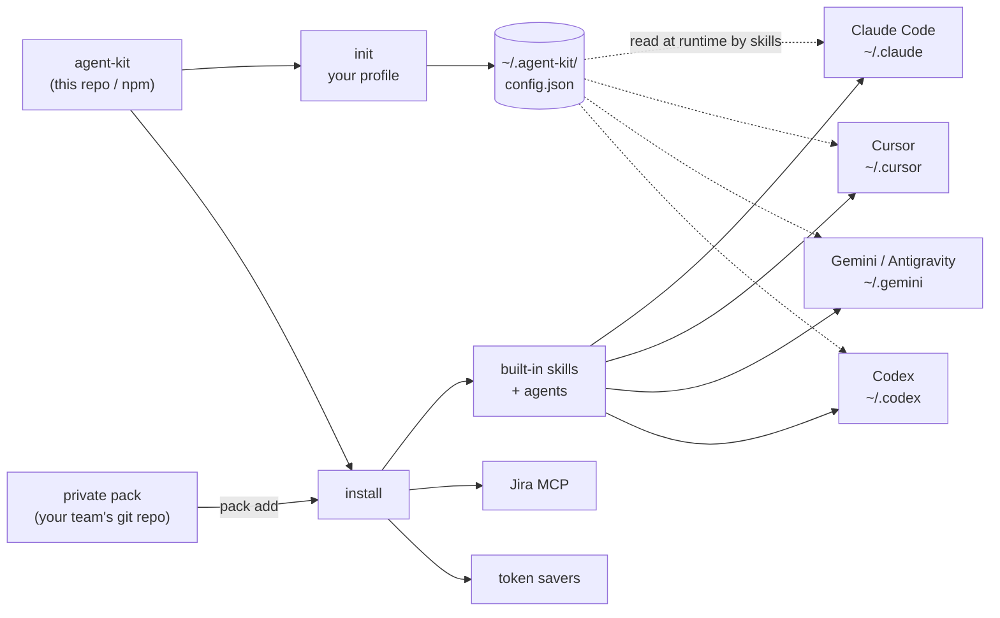
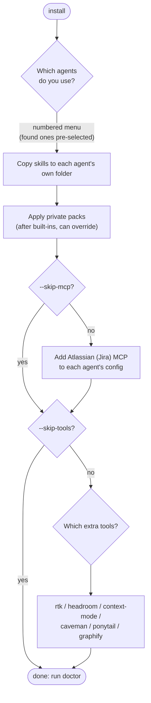

# Architecture

## How it fits together

## What `install` does

## Pieces

**Config.** `~/.agent-kit/config.json` is written by `init` and read by skills at runtime. Skills refer to values
with placeholders such as `<workspace>` and `<gitlab_user>`. The repo holds no real values. See [config.md](config.md).

**Manifests.** `manifests/agents.json` lists each supported agent (folders, MCP location). `manifests/tools.json`
lists each token-saver tool (commands per agent). The CLI reads them, so adding an agent or tool is a data edit.
See [agents.md](agents.md) and [tools.md](tools.md).

**Per-agent folders.** `install` copies `skills/` into each chosen agent's skills folder. Claude Code also gets
`agents/` (subagents are Claude-format only). Gemini, Antigravity and Codex additionally share `~/.agents/skills`.

**Packs.** After the built-in content, `install` applies each registered pack the same way. A pack can override a
built-in skill of the same name. See [packs.md](packs.md).

**Order of an install run.** skills and agents (built-in, then each pack), then Jira MCP (unless `--skip-mcp`),
then tools (unless `--skip-tools`). Every step is best-effort and reported; a missing prerequisite is skipped, not fatal.
`--dry-run` prints what would happen without changing anything.
