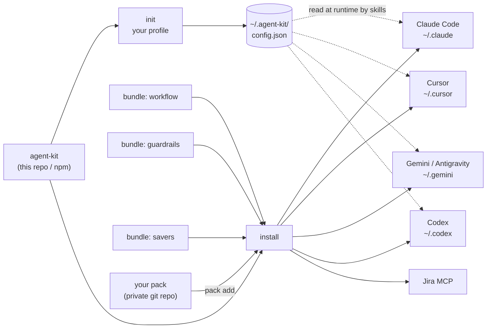
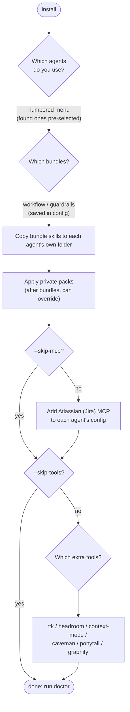

# Architecture

## How it fits together

`savers` holds tool recipes rather than skills, so it feeds the tools step instead of the per-agent skill folders.

## What `install` does

## Pieces

**Config.** `~/.agent-kit/config.json` is written by `init` and read by skills at runtime. Skills refer to values
with placeholders such as `<workspace>` and `<gitlab_user>`. The repo holds no real values. See [config.md](config.md).

**Bundles.** Content lives in `bundles/<name>/`. `workflow` and `guardrails` each hold `skills/` and `agents/`;
`savers` holds `tools.json`. `install` asks which bundles you want, saves the answer as `bundles` in the config, and
`--bundles=a,b` skips the question. Non-interactive repeat installs reuse the saved list.

**Targets and tools.** `targets.json` lists each supported agent (folders, MCP location).
`bundles/savers/tools.json` lists each token-saver tool (commands per agent). The CLI reads them, so adding an agent
or tool is a data edit. See [agents.md](agents.md) and [tools.md](tools.md).

**Per-agent folders.** `install` copies each chosen bundle's `skills/` into each chosen agent's skills folder. Claude
Code also gets the bundles' `agents/` (subagents are Claude-format only). Gemini, Antigravity and Codex additionally
share `~/.agents/skills`.

**Packs.** After the bundles, `install` applies each registered pack the same way. A pack can override a bundle
skill of the same name. See [packs.md](packs.md).

**Order of an install run.** skills and agents (chosen bundles, then each pack), then Jira MCP (unless `--skip-mcp`),
then tools (unless `--skip-tools`). Every step is best-effort and reported; a missing prerequisite is skipped, not fatal.
`--dry-run` prints what would happen without changing anything.
