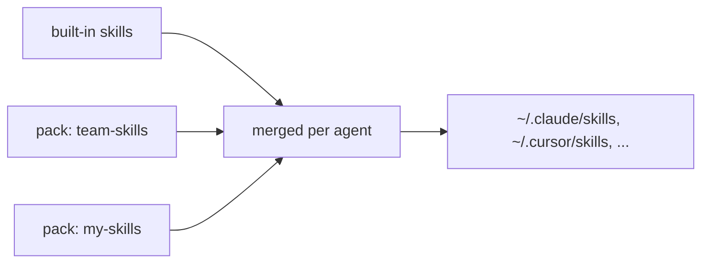

# Packs

A pack is any git repo (or local folder) with `skills/` and/or `agents/` at its root. Teams use packs for private
skills that do not belong in this public repo.



## Commands

```bash
node bin/cli.mjs pack add git@host:team/our-skills.git   # uses YOUR git access
node bin/cli.mjs pack add ./path/to/folder                # local folder, used in place
node bin/cli.mjs install                                  # re-applies every pack
node bin/cli.mjs pack update                              # git pull --ff-only on cloned packs
node bin/cli.mjs pack list
node bin/cli.mjs pack remove <name>
```

`install --pack=<git-url|path>` adds a pack and installs in one step.

Git packs are cloned (depth 1) into `~/.agent-kit/packs/<name>`. Local packs are not copied; the registered path
is used directly. Registered packs are listed under `packs` in `~/.agent-kit/config.json`.

## Override order

Built-in skills are installed first, then each pack in the order it was added. A later copy of a skill with the
same name replaces the earlier one. `pack remove` unregisters the pack but leaves already-installed copies; delete
those yourself.

## Privacy

Packs are cloned with each person's own git access, so only people you invite to the pack's repo can fetch it.
agent-kit stores no credentials.

## Example

See [examples/pack/](../examples/pack/) for a minimal working pack.
