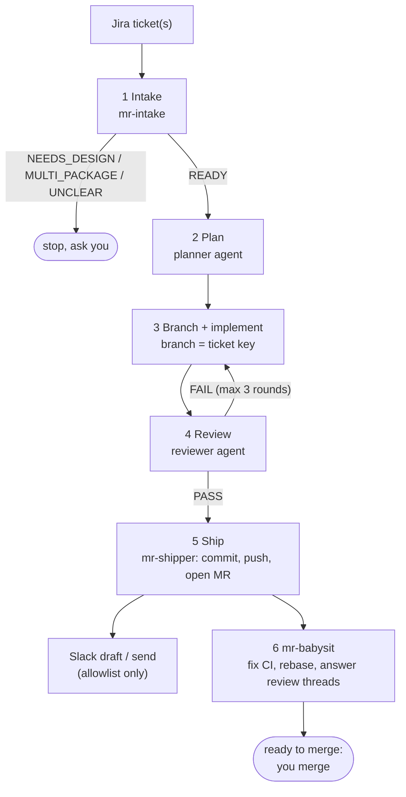

# Workflow

## Ticket to MR

## Workflow skills

| Skill | Use it for |
| --- | --- |
| `ticket-to-mr` | Jira ticket, branch, implement, commit, push, MR, reviewer follow-up |
| `ship` | the full pipeline above, for one or more tickets |
| `mr-babysit` | fix CI, rebase, triage and reply to review threads, report when mergeable |
| `mr-review` | review someone's MR against a rule set, post draft inline comments |
| `jira-transition` | move / resolve / comment on tickets, review a ticket before work |

## Subagents (Claude Code)

| Agent | Role |
| --- | --- |
| `mr-intake` | reads Jira tickets, finds the design link, picks the package, writes `ticket.md`; never edits code or ticket status |
| `mr-shipper` | commits, rebases, pushes, opens the MR with label and reviewers, drafts the Slack follow-up; never merges |
| `mr-reviewer` | reviews an MR against the engineering rules and posts draft inline comments |

## Frontend guardrail skills

For React Native + design-system projects: `mp-guardrails` (the rule checklist), `mp-token-usage`, `mp-spacing`,
`mp-unistyles`, `mp-component-structure`, `mp-component-swap`, `mp-types`, `mp-stories`, `mp-index-exports`,
`mp-translate`, `mp-migrate`.

Related subagents: `airasia-phoenix-analyst`, `airasia-phoenix-implementer`, `airasia-phoenix-reviewer`, and the
migration writers `mp-migration-analyst`, `mp-type-writer`, `mp-constants-utils-writer`, `mp-ui-writer`,
`mp-style-writer`, `mp-story-writer`, `mp-index-writer`.

## Safety rules

- Never merge, approve or close an MR.
- Never push to `main`.
- Never resolve a human review thread you did not address.
- No AI attribution in commits or MRs.
- Slack only to the people and channel in your config; with `auto_send` false, skills only draft.
